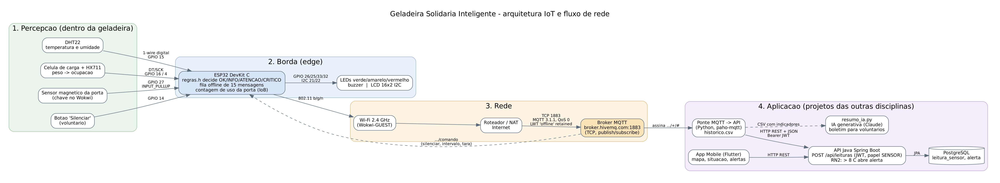
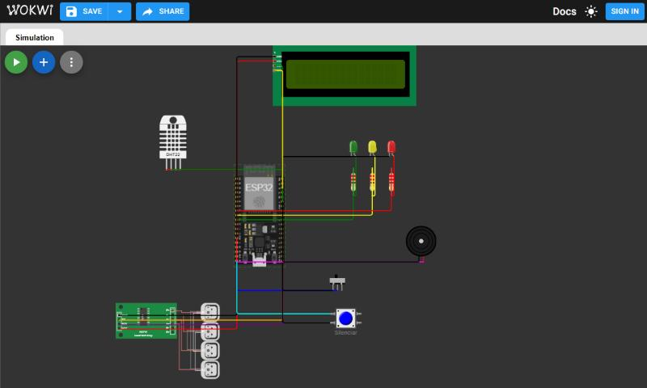
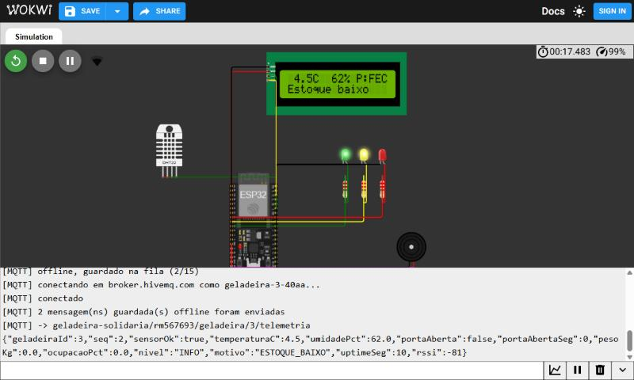
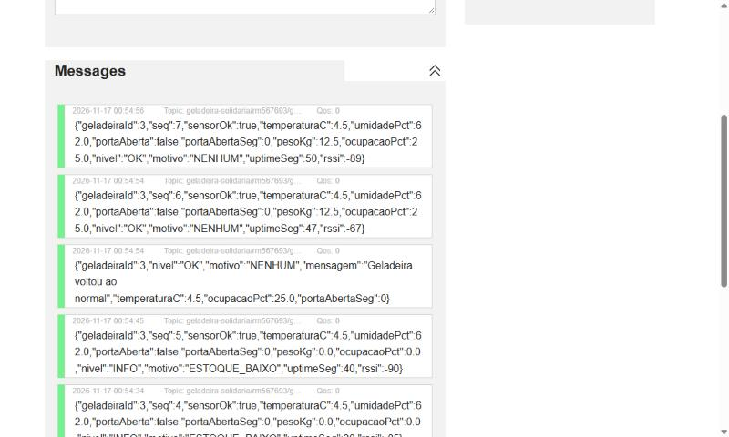
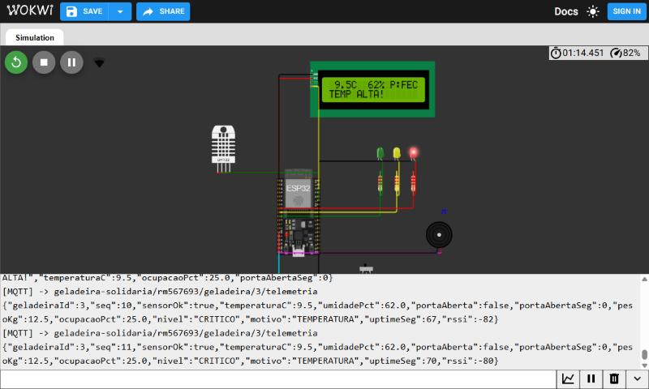
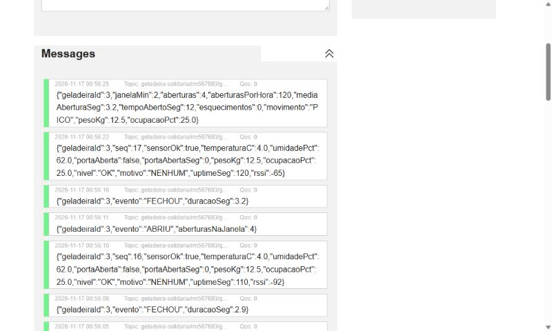
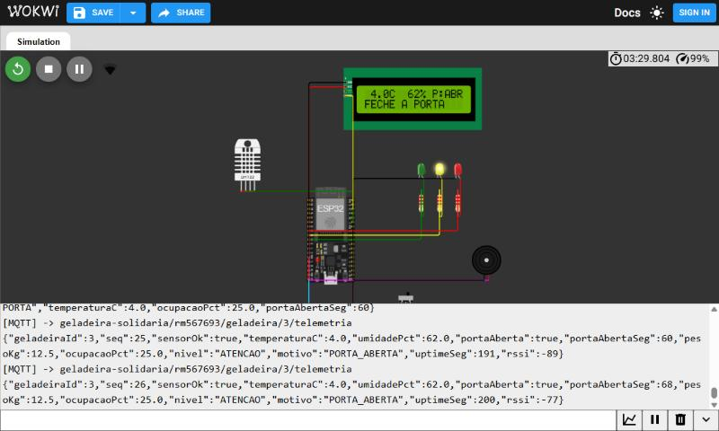
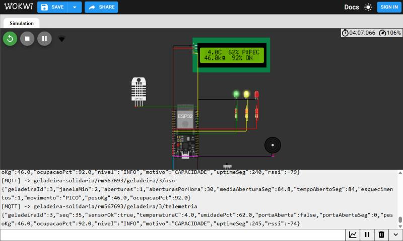

# Geladeira Solidária Inteligente: protótipo IoT

**Global Solution 2026/2 · CitizenTech · FIAP, 2º ano de ADS**
**Disciplina:** Disruptive Architectures: IoT, IoB & Generative IA

| Integrante | RM | Turma |
|---|---|---|
| Ruan Ribeiro | 567693 | 2TDSPA |

**Simulação no Wokwi:** https://wokwi.com/projects/480908095408093185

---

## 1. O problema e a solução

Geladeiras solidárias ficam em calçadas e praças: comércios e moradores deixam alimentos e qualquer pessoa retira o que precisa. Ninguém fica de plantão ao lado delas. Se a refrigeração falha num fim de semana, leite e marmitas estragam e podem fazer mal a quem come. Se a porta fica aberta, o mesmo acontece. E uma geladeira pode estar lotada enquanto a do bairro vizinho está vazia.

Este protótipo é o **nó IoT** que vai dentro de cada geladeira. Um ESP32 mede temperatura, umidade, peso dos alimentos e abertura da porta, decide na hora se há risco, avisa quem está perto (LEDs, buzzer e LCD) e publica tudo por **MQTT**. Uma ponte entrega as leituras à **API Java** do projeto, que abre os alertas para os voluntários e alimenta o app mobile.

O projeto cobre os três temas da disciplina:

| Tema | Onde aparece |
|---|---|
| **IoT** | Sensores, decisão na borda (ESP32), Wi-Fi, MQTT, comandos remotos, integração com a API |
| **IoB** (Internet of Behaviors) | A geladeira mede **como a comunidade usa**: quantas vezes a porta abre, por quanto tempo, horários de pico e quantas vezes ela é esquecida aberta (seção 6) |
| **IA generativa** | Um boletim diário escrito por IA para o grupo de voluntários, a partir dos indicadores calculados (seção 7) |

**ODS:** 2 (Fome zero), 3 (Saúde e bem-estar), 11 (Cidades e comunidades sustentáveis) e 12 (Consumo e produção responsáveis, menos desperdício de alimentos).

## 2. Arquitetura e fluxo de rede



O caminho de uma leitura, do sensor até a tela do voluntário:

1. **Percepção.** O DHT22 manda temperatura e umidade por um fio digital (GPIO 15). A célula de carga passa o peso pelo HX711 (GPIO 16 e 4). O sensor magnético da porta é uma entrada digital com pull-up (GPIO 27).
2. **Borda (edge).** A cada 2 s o ESP32 lê tudo e aplica as regras de `regras.h`. A decisão é tomada **ali mesmo**: LED, buzzer e LCD funcionam mesmo sem internet.
3. **Rede local.** O ESP32 entra no Wi-Fi de 2,4 GHz (no simulador, a rede `Wokwi-GUEST`). O roteador faz o NAT e leva o tráfego para a internet.
4. **Transporte.** O ESP32 abre uma conexão **TCP na porta 1883** com o broker MQTT e **publica** em tópicos. Ninguém precisa saber o IP da geladeira: quem quer os dados **assina** o tópico no broker.
5. **Aplicação.** A ponte (Python) assina `.../+/#`, grava o histórico e envia cada telemetria para `POST /api/leituras` da API Java, por HTTP com token JWT do papel SENSOR. A API grava no PostgreSQL e, acima de 8 °C, abre o alerta de temperatura que o app mostra.
6. **Volta.** Pelo tópico `.../comando`, um voluntário pode silenciar o buzzer, mudar o intervalo de envio ou zerar a balança, sem ir até a geladeira.

## 3. Componentes e ligações

| Componente | Função | Pino do ESP32 |
|---|---|---|
| ESP32 DevKit C v4 | Microcontrolador com Wi-Fi | — |
| DHT22 | Temperatura (−40 a 80 °C, ±0,5 °C) e umidade | GPIO 15 (dados), 3V3, GND |
| Célula de carga 50 kg + HX711 | Peso dos alimentos → ocupação | DT = GPIO 16, SCK = GPIO 4, 5V, GND |
| Chave deslizante | Faz o papel do sensor magnético (reed switch) da porta | GPIO 27 e GND |
| Botão azul "Silenciar" | Voluntário cala o buzzer por 5 min | GPIO 14 e GND |
| LED verde / amarelo / vermelho (+ 220 Ω) | Situação da geladeira | GPIO 26 / 25 / 33 |
| Buzzer | Alarme sonoro | GPIO 32 |
| LCD 16x2 I2C (endereço 0x27) | Mostra temperatura, porta, peso e situação | SDA = GPIO 21, SCL = GPIO 22 |

Os LEDs mostram o nível: **verde** = OK, **verde + amarelo** = aviso de logística (lotada ou estoque baixo), **amarelo** = atenção, **vermelho** = crítico.

## 4. Tópicos MQTT

Raiz: `geladeira-solidaria/rm567693/geladeira/<id>/`. O RM no caminho evita misturar mensagens com outros projetos no broker público. O protótipo é a geladeira **3** (Heliópolis, a mesma da API).

| Tópico | Direção | Quando | Exemplo |
|---|---|---|---|
| `.../3/telemetria` | ESP32 → | A cada 10 s e na hora em que o nível muda | `{"geladeiraId":3,"seq":12,"sensorOk":true,"temperaturaC":4.5,"umidadePct":62.0,"portaAberta":false,"portaAbertaSeg":0,"pesoKg":12.5,"ocupacaoPct":25.0,"nivel":"OK","motivo":"NENHUM","uptimeSeg":120,"rssi":-55}` |
| `.../3/alerta` | ESP32 → | Quando o nível ou o motivo muda | `{"geladeiraId":3,"nivel":"CRITICO","motivo":"TEMPERATURA","mensagem":"TEMP ALTA!","temperaturaC":9.5,"ocupacaoPct":25.0,"portaAbertaSeg":0}` |
| `.../3/porta` | ESP32 → | Na hora em que a porta abre ou fecha | `{"geladeiraId":3,"evento":"FECHOU","duracaoSeg":5.0}` |
| `.../3/uso` | ESP32 → | A cada janela de uso (2 min no protótipo) | `{"geladeiraId":3,"janelaMin":2,"aberturas":4,"aberturasPorHora":120,"mediaAberturaSeg":5.0,"tempoAbertoSeg":20,"esquecimentos":0,"movimento":"PICO","pesoKg":12.5,"ocupacaoPct":25.0}` |
| `.../3/status` | ESP32 → (retained) | `{"online":true}` ao conectar. Se cair sem avisar, o **broker** publica `{"online":false}` (Last Will) | |
| `.../3/comando` | → ESP32 | Quando alguém quer agir de longe | `{"acao":"silenciar"}`, `{"acao":"intervalo","segundos":5}`, `{"acao":"tara"}`, `{"acao":"status"}` |

## 5. Regras de decisão (no ESP32)

Avaliadas a cada 2 s, da mais grave para a menos grave. A primeira que bater define o nível.

| Prioridade | Condição | Nível | LED | Buzzer |
|---|---|---|---|---|
| 1 | DHT22 não responde | CRÍTICO (`SENSOR_FALHA`) | vermelho | bipe rápido |
| 2 | Acima de 8 °C em **3 leituras seguidas** | CRÍTICO (`TEMPERATURA`) | vermelho | bipe rápido |
| 3 | Porta aberta há mais de 3 min | CRÍTICO (`PORTA_ABERTA`) | vermelho | bipe rápido |
| 4 | Porta aberta há mais de 60 s | ATENÇÃO (`PORTA_ABERTA`) | amarelo | bipe curto a cada 1 s |
| 5 | Acima de 5 °C | ATENÇÃO (`TEMPERATURA_SUBINDO`) | amarelo | — |
| 6 | Abaixo de 0 °C | ATENÇÃO (`CONGELANDO`) | amarelo | — |
| 7 | Umidade acima de 85% | ATENÇÃO (`UMIDADE`) | amarelo | — |
| 8 | Ocupação ≥ 90% | INFO (`CAPACIDADE`) | verde + amarelo | — |
| 9 | Ocupação ≤ 20% | INFO (`ESTOQUE_BAIXO`) | verde + amarelo | — |
| — | Nenhuma das anteriores | OK | verde | — |

- **8 °C, 90% e 20%** são os mesmos limites da API Java (RN1 e RN2), então o ESP32 e o servidor nunca discordam.
- **3 leituras seguidas:** quando alguém abre a porta, a temperatura sobe por alguns instantes e volta. Exigir que o calor se mantenha evita alarme falso; a primeira leitura quente já acende o amarelo.
- **Temperatura antes de lotação:** comida estragada é risco à saúde; geladeira cheia é problema de logística. Por isso lotação só acende um aviso e nunca toca o buzzer.
- **Silenciar** cala só o buzzer: o LED vermelho continua aceso. Se surgir um problema mais grave, o silêncio é cancelado.

## 6. IoB: o comportamento de uso

Internet of Behaviors é usar dados de dispositivos para entender **comportamentos** e agir sobre eles. Aqui o comportamento é o da comunidade com a geladeira, sem identificar ninguém: o sensor de porta não sabe quem abriu.

A cada janela (2 min no protótipo para dar tempo de ver na apresentação; em produção seria 1 h), o ESP32 publica em `.../uso`:

- **aberturas** e **aberturas por hora**, classificadas em PARADO, BAIXO, MODERADO ou PICO;
- **tempo médio** com a porta aberta;
- **esquecimentos:** quantas vezes a porta passou de 60 s aberta.

O que isso muda na prática:

- **Horário de reposição:** os voluntários repõem antes do horário de pico, e não quando a geladeira já esvaziou.
- **Campanha no local:** muitos esquecimentos indicam que vale colar um aviso "feche a porta" ou trocar a mola da porta.
- **Geladeira pouco usada** (PARADO por dias) pode estar num lugar ruim, e vale mudá-la de endereço.

## 7. IA generativa: boletim para os voluntários

`ponte/resumo_ia.py` lê o histórico gravado pela ponte, calcula os indicadores de cada geladeira (temperatura média e máxima, % do tempo em estado crítico, ocupação atual, aberturas, pico e esquecimentos) e pede a um modelo de IA generativa (Claude, da Anthropic) que escreva um aviso curto, em português simples, para o grupo de mensagens dos voluntários.

A divisão de papéis é proposital:

- **Quem decide** se há risco são as regras do ESP32 e da API: testadas, previsíveis e iguais todas as vezes.
- **A IA só escreve** o texto, a partir de números já calculados. O prompt proíbe inventar números, e nenhum dado pessoal é enviado. Uma IA generativa pode errar, então ela não decide se um alimento é seguro.
- **Sem chave de API** (ou sem internet), o script monta o boletim por um modelo de texto fixo. O sistema nunca depende da IA para funcionar.

Exemplo do boletim gerado pelo modelo de texto fixo, com o histórico dos testes:

```
Geladeira 3:
  - URGENTE: ficou em estado critico em 29% das leituras (maxima de 9.9 C). Confira a refrigeracao e os alimentos refrigerados.
  - Ocupacao atual: 20% (quase vazia, precisa de reposicao).
  - Porta aberta 5 vezes, mais movimento por volta das 21:35.
  - A porta ficou esquecida aberta 1 vez(es): vale reforcar o aviso 'feche a porta' no local.
```

## 8. Como rodar

### 8.1 Simulação no Wokwi (principal)

1. Entre em [wokwi.com](https://wokwi.com), faça login e crie um projeto novo com **ESP32**.
2. Na aba `sketch.ino`, apague tudo e cole o conteúdo de `firmware/sketch.ino`.
3. Na aba `diagram.json`, apague tudo e cole o conteúdo de `firmware/diagram.json`. O circuito aparece montado.
4. Clique na setinha ao lado das abas → **New file** → `regras.h`, e cole o conteúdo de `firmware/regras.h`.
5. Na aba **Library Manager**, adicione as 4 bibliotecas de `firmware/libraries.txt`: `DHT sensor library for ESPx`, `HX711`, `LiquidCrystal I2C` e `PubSubClient`.
6. Clique em **▶** (Start). No Serial Monitor deve aparecer `[WiFi] conectando...` e, em alguns segundos, `[MQTT] conectado`.
7. Clique em **Save** para guardar o projeto na sua conta.

Para só ver a simulação pronta, abra o [projeto salvo no Wokwi](https://wokwi.com/projects/480908095408093185) e clique em **▶**.

**Como mexer nos sensores durante a simulação:** clique no DHT22 para mudar temperatura e umidade; clique na célula de carga para mudar o peso; clique na chave para abrir ou fechar a porta; clique no botão azul para silenciar.

**Para ver as mensagens MQTT sem instalar nada:** abra o [cliente web da HiveMQ](https://www.hivemq.com/demos/websocket-client/), clique em **Connect**, depois em **Add New Topic Subscription** e assine `geladeira-solidaria/rm567693/geladeira/3/#`. Para mandar um comando, publique no tópico `geladeira-solidaria/rm567693/geladeira/3/comando`.

### 8.2 Ponte MQTT → API Java (opcional, integra com as outras disciplinas)

Com a API Java rodando (`geladeira-solidaria-api`, em `http://localhost:8080`) e o Wokwi ligado:

```bash
cd ponte
pip install -r requirements.txt
copy .env.example .env        # Windows (no Linux/Mac: cp .env.example .env)
python ponte_mqtt_api.py
```

O terminal mostra cada telemetria, alerta e evento de porta, e cada leitura salva na API. Para só acompanhar as mensagens, sem a API, use `ENVIAR_API=false` no `.env`.

Depois de alguns minutos de simulação, gere o boletim:

```bash
python resumo_ia.py           # usa a IA se ANTHROPIC_API_KEY estiver no .env
python resumo_ia.py --sem-ia  # sempre o texto fixo
```

### 8.3 Testes automatizados no computador (opcional)

`testes/simulacao_host.cpp` roda o **mesmo** `sketch.ino` no PC, trocando o hardware por versões falsas (pasta `testes/stubs`) e controlando o relógio. Assim os 12 casos da seção 9 rodam em menos de 1 segundo. Precisa de um compilador C++ (g++):

```bash
cd testes
g++ -std=c++17 -Istubs -x c++ simulacao_host.cpp -o simulacao
./simulacao
```

Resultado esperado: `Resultado: 48 de 48 verificacoes passaram`.

## 9. Casos de teste

### 9.1 No Wokwi (prints na seção 12)

| # | Como testar | Resultado esperado |
|---|---|---|
| CT01 | Iniciar a simulação | LCD mostra "Geladeira Solidaria #3" e depois `4.5C  62% P:FEC`; Serial mostra `[MQTT] conectado`; no HiveMQ chega `status` com `"online":true` |
| CT02 | Deixar rodando com 4,5 °C, porta fechada e 12,5 kg na balança | Só o LED verde; telemetria a cada 10 s com `"nivel":"OK"` e `"ocupacaoPct":25.0` |
| CT03 | Mudar o DHT22 para 9,5 °C | Primeiro o amarelo (`TEMPERATURA_SUBINDO`); ~6 s depois, vermelho + buzzer e alerta `CRITICO / TEMPERATURA` |
| CT04 | Apertar o botão Silenciar | Buzzer para; o LED vermelho continua aceso |
| CT05 | Voltar o DHT22 para 4 °C | Verde; alerta `"Geladeira voltou ao normal"` |
| CT06 | Abrir a porta (chave) e esperar | Evento `ABRIU` na hora; com 60 s, amarelo + bipe curto e LCD "FECHE A PORTA"; com 3 min, vermelho. Fechar: evento `FECHOU` com a duração |
| CT07 | Abrir e fechar a porta várias vezes e esperar a janela de 2 min | Mensagem em `.../uso` com aberturas, média, esquecimentos e movimento |
| CT08 | Mudar o peso para 46 kg, depois para 5 kg | 46 kg: verde + amarelo, `CAPACIDADE` (92%), sem buzzer. 5 kg: `ESTOQUE_BAIXO` (10%) |
| CT09 | Publicar `{"acao":"intervalo","segundos":5}` no tópico de comando | Serial mostra `[CMD] telemetria a cada 5 s` e a telemetria passa a sair a cada 5 s |
| CT10 | Mudar a umidade para 90% | Amarelo, `UMIDADE` |
| CT11 | Mudar a temperatura para −2 °C | Amarelo, `CONGELANDO` |
| CT12 | Parar a simulação com o HiveMQ aberto | Em até ~30 s o broker publica `{"online":false}` no `status` (Last Will) |
| CT13 | Rodar a ponte com a API Java e subir a temperatura para 9,5 °C | Terminal mostra `API: leitura #N ... salva` e `API ABRIU ALERTA DE TEMPERATURA`; `GET /api/alertas?resolvido=false` no Swagger mostra o alerta |

### 9.2 Automatizados (simulação no PC)

Resultado da última execução: **48 de 48 verificações passaram**, em 12 casos:

| # | Caso | O que é verificado |
|---|---|---|
| CT01 | Broker fora do ar na partida | Nada publicado; mensagens vão para a fila; ao reconectar, a fila é enviada e o status `online` sai |
| CT02 | Operação normal | Telemetria a cada 10 s, JSON correto, só LED verde, buzzer desligado, texto do LCD |
| CT03 | Temperatura 9,5 °C | ATENÇÃO na 1ª leitura, CRÍTICO na 3ª, LED vermelho, alerta publicado, buzzer tocando |
| CT04 | Botão Silenciar | Buzzer cala, LED continua |
| CT05 | Temperatura normaliza | Volta a OK e publica o alerta de normalização |
| CT06 | Porta esquecida | ABRIU, ATENÇÃO aos 60 s, CRÍTICO aos 3 min, FECHOU com duração |
| CT07 | IoB | Resumo de uso com aberturas, média e esquecimentos |
| CT08 | Lotação e estoque baixo | 92% = CAPACIDADE sem buzzer; 10% = ESTOQUE_BAIXO |
| CT09 | Comandos | Intervalo válido aplicado, inválido ignorado, tara da balança, silenciar |
| CT10 | Falha do DHT22 | CRÍTICO / SENSOR_FALHA e `sensorOk:false` na telemetria |
| CT11 | Wi-Fi cai durante um alerta | LED e buzzer seguem funcionando; o alerta fica na fila e é entregue ao reconectar |
| CT12 | Fila cheia | Nunca passa de 15 mensagens (descarta a mais antiga) |

Esses testes acharam um defeito real durante o desenvolvimento: ao fechar a janela de uso, o relógio da porta era zerado, e uma porta esquecida aberta "perdia" o alerta crítico. Foi corrigido separando o tempo do alerta do tempo contado na janela (`portaAbertaDesde` e `portaContadaDesde`).

A ponte também foi testada com um broker Mosquitto local, reenviando as mensagens geradas pelo firmware: leituras guardadas com a API fora do ar e entregues quando ela voltou, novo login quando o token venceu, mensagem que não é JSON ignorada sem derrubar a ponte e telemetria com `sensorOk:false` não enviada à API.

## 10. Justificativas técnicas

| Escolha | Por quê |
|---|---|
| **ESP32** em vez de Arduino Uno | Tem Wi-Fi embutido, 240 MHz e memória para a fila offline. O Uno precisaria de um módulo Wi-Fi à parte. |
| **DHT22** em vez de DHT11 | O DHT11 só mede de 0 a 50 °C, com ±2 °C. A regra trabalha com 5 °C e 8 °C, então ±2 °C não serve. O DHT22 tem ±0,5 °C e mede abaixo de zero. |
| **Célula de carga** para a lotação | O peso é a mesma unidade da API (capacidade em kg), então a ocupação do ESP32 e a da API são comparáveis. Um sensor ultrassônico mediria altura, que não diz nada com alimentos de tamanhos diferentes. |
| **Sensor magnético** na porta, ligado ao GND com pull-up | Fio solto lê "aberta". Uma falha no sensor nunca esconde uma porta aberta (falha segura). |
| **MQTT** em vez de HTTP direto do ESP32 | O cabeçalho é de poucos bytes, a conexão fica aberta (sem refazer TCP a cada envio) e o modelo publish/subscribe deixa vários consumidores (ponte, app, painel) lerem a mesma geladeira sem que ela saiba de nenhum. Também dá o **Last Will**, que avisa quando a geladeira cai. |
| **QoS 0** | Telemetria a cada 10 s: perder uma leitura não faz falta, a próxima chega logo. Alertas são reenviados pela telemetria seguinte, que carrega o nível atual. |
| **Decisão na borda** | Se a internet cair, a geladeira continua avisando quem está perto (LED, buzzer, LCD). A nuvem não é ponto único de falha. |
| **Fila offline** | Mensagens de quando o Wi-Fi caiu são entregues ao voltar, inclusive o alerta crítico. |
| **Ponte** em vez de o ESP32 chamar a API | A senha da API não fica gravada em cada geladeira, o ESP32 só precisa saber MQTT, e se a API cair as geladeiras não são afetadas. |
| **Lógica separada em `regras.h`** | As regras não dependem de hardware, então são testadas no PC, e os limites ficam todos num lugar só. |
| **Código sem `delay` longo** | Tudo é controlado por `millis()`. O ESP32 lê a porta, o botão e o broker o tempo todo, sem travar enquanto espera. |

## 11. Limitações e próximos passos

- **Simulação, não hardware.** O protótipo roda no Wokwi. Num circuito real, a célula de carga precisa ser calibrada com um peso conhecido, e o DHT22 mede o ar da geladeira, não o alimento (uma sonda DS18B20 dentro de um copo d'água imita melhor a temperatura do alimento).
- **Broker público sem segurança.** O `broker.hivemq.com` é aberto: qualquer um que souber o tópico lê as mensagens e pode mandar comandos. Em produção: broker próprio (Mosquitto ou HiveMQ Cloud), **TLS na porta 8883**, usuário e senha por geladeira e ACL limitando cada uma ao próprio tópico.
- **Wi-Fi do local.** Geladeira na calçada nem sempre tem Wi-Fi. Alternativas: chip 4G (módulo SIM7600) ou LoRaWAN, que tem longo alcance e baixo consumo.
- **Fila em memória.** Se o ESP32 reiniciar sem conexão, as mensagens da fila se perdem. Daria para guardar no flash (LittleFS).
- **Sem relógio.** O ESP32 não manda a hora da leitura; a API usa a hora em que recebeu. Com NTP, a hora sairia da própria geladeira, o que importa para as mensagens que ficaram na fila.
- **Peso e uso ainda não vão para a API.** A API Java recebe temperatura, umidade e porta. Peso, ocupação e os dados de uso ficam no MQTT e no histórico da ponte. O próximo passo seria criar esses campos na API.
- **Uma geladeira por firmware.** O id (3) está no código. Em escala, cada placa leria o id de uma configuração gravada na instalação.
- **IA generativa depende de serviço externo e de chave paga.** Por isso o boletim tem o modo sem IA, e a IA nunca toma decisão de segurança.

## 12. Evidências

Prints da simulação no Wokwi e do cliente web da HiveMQ, guardados em `docs/evidencias/`.

### 01. Circuito montado

ESP32, DHT22, HX711 com a célula de carga, chave da porta, botão Silenciar, LEDs, buzzer e LCD.



### 02. Wi-Fi e MQTT conectados (CT01)

O Serial mostra `[MQTT] conectado` e as 2 mensagens guardadas na fila offline sendo enviadas logo depois. A balança ainda estava em 0 kg, por isso o aviso `ESTOQUE_BAIXO` (verde + amarelo).



### 03. Telemetria chegando no HiveMQ (CT02 e CT05)

Com 12,5 kg na balança, a telemetria passa para `OK` com 25% de ocupação, e chega o alerta "Geladeira voltou ao normal".



### 04. Alerta crítico de temperatura (CT03)

Com 9,5 °C, o LED vermelho acende, o LCD mostra "TEMP ALTA!" e a telemetria sai com `CRITICO / TEMPERATURA`.



### 05. Uso da porta, IoB (CT06 e CT07)

Os eventos `ABRIU` e `FECHOU` com a duração, e o resumo da janela de uso: 4 aberturas, média de 3,2 s e movimento `PICO`.



### 06. Porta esquecida aberta (CT06)

Com 60 s de porta aberta, o LED amarelo acende, o LCD mostra "FECHE A PORTA" e a telemetria sai com `ATENCAO / PORTA_ABERTA`.



### 07. Comando remoto de intervalo (CT09)

Depois do comando `{"acao":"intervalo","segundos":5}` publicado no HiveMQ, o Serial mostra `[CMD] telemetria a cada 5 s` e a telemetria passa a sair de 5 em 5 s.


### 08. Geladeira lotada (CT08)

Com 46 kg (92%), acendem verde + amarelo, com `INFO / CAPACIDADE` e sem buzzer. O resumo de uso dessa janela registra 1 esquecimento de porta.



## 13. Estrutura

```
firmware/
├── sketch.ino       programa do ESP32
├── regras.h         regras de decisão e de uso (IoB), sem hardware
├── diagram.json     circuito do Wokwi
└── libraries.txt    bibliotecas do Wokwi
ponte/
├── ponte_mqtt_api.py   MQTT -> API Java + histórico CSV
├── resumo_ia.py        boletim para voluntários (IA generativa)
├── requirements.txt
└── .env.example
testes/
├── simulacao_host.cpp  12 casos de teste rodando o sketch no PC
└── stubs/              versões falsas das bibliotecas de hardware
docs/
├── arquitetura.png     diagrama de arquitetura e rede (fonte: arquitetura.dot)
└── evidencias/         prints da simulação (seção 12)
```

## 14. Uso de IA generativa

Este projeto foi desenvolvido com apoio do Claude (Anthropic) para gerar a estrutura inicial do firmware, da ponte, dos testes e da documentação. Todo o código foi revisado, executado e testado pelo integrante, que é responsável pelo conteúdo entregue. Além disso, a própria solução usa IA generativa no boletim para voluntários (seção 7).
